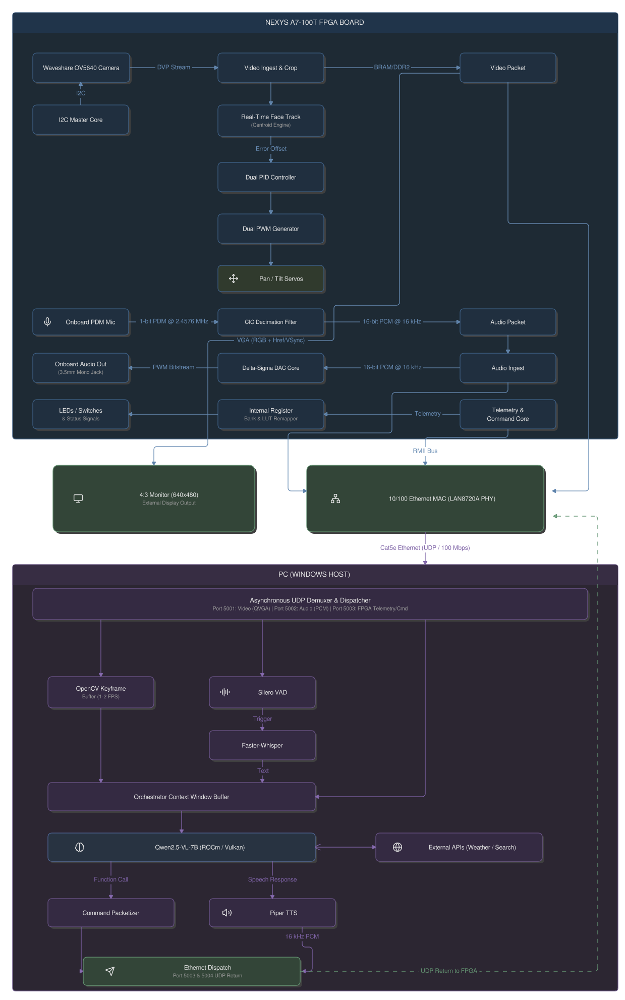

# Heterogeneous FPGA-Accelerated Multimodal Active Vision System

An FPGA-centric active vision and audio platform that combines real-time
face tracking, servo-driven pan/tilt control, audio capture/playback, and
Ethernet telemetry on an Artix-7 FPGA, paired with a host-side multimodal
AI pipeline (speech recognition, vision-language model, and speech
synthesis) for natural voice- and vision-driven interaction.

## Architecture



The system is split into two halves connected over Ethernet:

- **FPGA subsystem (Nexys A7-100T)** — captures video and audio, performs
  real-time face tracking and servo control in hardware, and streams
  video/audio/telemetry to the host over UDP while accepting command
  packets back.
- **Host subsystem (PC)** — demultiplexes the incoming UDP streams,
  buffers keyframes and audio, runs speech and vision-language models to
  interpret the scene and any spoken input, and dispatches responses
  (speech audio, function calls, telemetry commands) back to the FPGA.

### Video pipeline
1. **Waveshare OV5640 camera** → configured over **I2C** (I2C Master Core).
2. Camera streams a **DVP** signal into the **Video Ingest & Crop** block.
3. Cropped frames are buffered in **BRAM/DDR2** as video packets.
4. Frames feed the **Real-Time Face Track (Centroid Engine)**, which
   computes a positional error offset.
5. The error offset drives a **Dual PID Controller** → **Dual PWM
   Generator** → **Pan/Tilt Servos**, closing the tracking loop entirely
   on-FPGA.
6. Video packets are also forwarded to the host over Ethernet
   (**Port 5001**, QVGA) and can be mirrored to a local **4:3 VGA
   monitor (640×480)**.

### Audio pipeline
1. **Onboard PDM microphone** → **CIC Decimation Filter** → 1-bit PDM
   @ 2.4576 MHz is converted to **16-bit PCM @ 16 kHz** audio packets,
   sent to the host on **Port 5002**.
2. On the return path, 16-bit PCM audio from the host is ingested by the
   FPGA and driven out through a **Delta-Sigma DAC Core** to the
   **onboard 3.5 mm mono audio jack**.

### Control / telemetry pipeline
- **LEDs / switches & status signals** are exposed through an **Internal
  Register Bank & LUT Remapper** to a **Telemetry & Command Core**.
- Telemetry and commands move over a **10/100 Ethernet MAC (LAN8720A
  PHY)** via **RMII**, carried over **Cat5e Ethernet (UDP, 100 Mbps)** to
  **Port 5003** (and returned on **Ports 5003/5004**).

### Host-side AI orchestration
1. An **Asynchronous UDP Demuxer & Dispatcher** on the PC splits incoming
   traffic by port: video (5001), audio (5002), and FPGA
   telemetry/commands (5003).
2. Video frames are buffered by an **OpenCV Keyframe Buffer (1–2 FPS)**.
3. Audio is gated by **Silero VAD** and transcribed with
   **Faster-Whisper** on trigger.
4. Transcripts and keyframes feed an **Orchestrator Context Window
   Buffer**, which supplies **Qwen2.5-VL-7B** (running via **ROCm /
   Vulkan**) with text and image context, optionally calling out to
   **external APIs** (weather, search) via function calling.
5. Model responses are split into a **Command Packetizer** (function
   calls → back to the FPGA telemetry/command port) and **Piper TTS**
   (speech responses), both dispatched back over Ethernet as
   **UDP returns** to the FPGA (16 kHz PCM audio, command packets).

## Hardware

| Component | Role |
|---|---|
| AMD/Xilinx Nexys A7-100T (Artix-7 100T) | Main FPGA compute/control board |
| Waveshare OV5640 camera module | DVP video input |
| 2× hobby servo (pan + tilt) | Actuation for the tracking gimbal |
| Onboard PDM MEMS microphone | Audio input |
| 3.5 mm mono audio jack | Audio output |
| LAN8720A Ethernet PHY | 10/100 Ethernet (RMII) |
| Cat5e cable | FPGA ↔ host link |
| 4:3 VGA monitor (640×480), optional | Local video monitoring |
| Host PC with ROCm/Vulkan-capable GPU | Runs VAD, ASR, VLM, TTS, orchestrator |

## Repository structure

> TODO: adjust to match the actual repo layout.

```
.
├── fpga/            # HDL sources, constraints, Vivado/Vivado-ML project
│   ├── video/       # I2C master, DVP ingest/crop, BRAM/DDR2 framebuffer
│   ├── tracking/     # Centroid engine, dual PID + PWM generation
│   ├── audio/        # CIC decimation, delta-sigma DAC core
│   ├── net/          # Ethernet MAC/RMII interface, UDP packetizers
│   └── telemetry/    # Register bank, LUT remapper, command core
├── host/            # Python host-side pipeline
│   ├── net/          # UDP demuxer/dispatcher
│   ├── vision/        # OpenCV keyframe buffering
│   ├── audio/         # Silero VAD, Faster-Whisper integration, Piper TTS
│   └── orchestrator/  # Context window buffer, Qwen2.5-VL-7B, function calling
├── flowchart.svg    # System architecture diagram (referenced above)
└── README.md
```

## Build & setup

### 1. FPGA bitstream
```bash
# Open the Vivado project (adjust path/version as needed)
vivado -mode gui fpga/project.xpr
```
- Run synthesis, implementation, and generate the bitstream.
- Program the Nexys A7-100T over JTAG (or update the on-board flash for
  standalone boot).

### 2. FPGA network/board configuration
- Set the board's IP address and destination host IP in the telemetry
  core's configuration (see `fpga/net/`).
- Confirm the LAN8720A PHY is wired for RMII and linked at 100 Mbps.

### 3. Host environment
```bash
python -m venv venv
source venv/bin/activate        # or venv\Scripts\activate on Windows
pip install -r host/requirements.txt
```
Typical host dependencies: `opencv-python`, `silero-vad`, `faster-whisper`,
`piper-tts`, and a ROCm- or Vulkan-enabled inference backend for
Qwen2.5-VL-7B.

### 4. Run the host pipeline
```bash
cd host
python -m orchestrator.main --fpga-ip 192.168.1.100
```
Video/audio/telemetry ports are fixed by `docs/wire_protocol.md` (5001-5004);
see that doc for the full packet layout both sides build against.

### 5. Verify the link
- Confirm video packets arrive on port 5001 and render in the keyframe
  buffer.
- Speak near the microphone and confirm Silero VAD triggers a
  Faster-Whisper transcription.
- Confirm the pan/tilt servos track a face placed in front of the camera.

## License

This project is licensed under the MIT License. See [LICENSE](./LICENSE)
for details.
